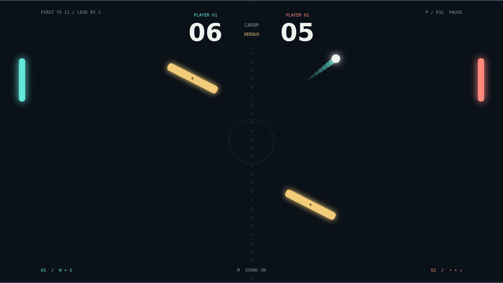

# Carom

Two paddles. One ball. No straight answers. Carom is a fast, top-down duel where a
well-timed flick can turn a safe return into a shot your opponent never saw coming.
Take on the computer in Solo or share a keyboard for a local Versus grudge match.

The opening serve gives you a moment to find your footing. Then each paddle hit
raises the pace: defend your edge, catch the ball near the tip to cut a sharper
angle, and keep your eye on the two turning bars in midfield. First to eleven
wins, but match point only counts when you're two clear.

Move as you strike and the ball carries your spin. Its trail bends through the
dark court, hanging on to that curve even after a wall bounce. Hold your ground
for a clean return or sweep into contact to make the next flight harder to read.

The obstacles sway and rotate together, opening lanes and closing them again.
Bank a shot off a tilted face, thread the gap, or let a curling return take the
long way home. In Carom, the angle is everything.

